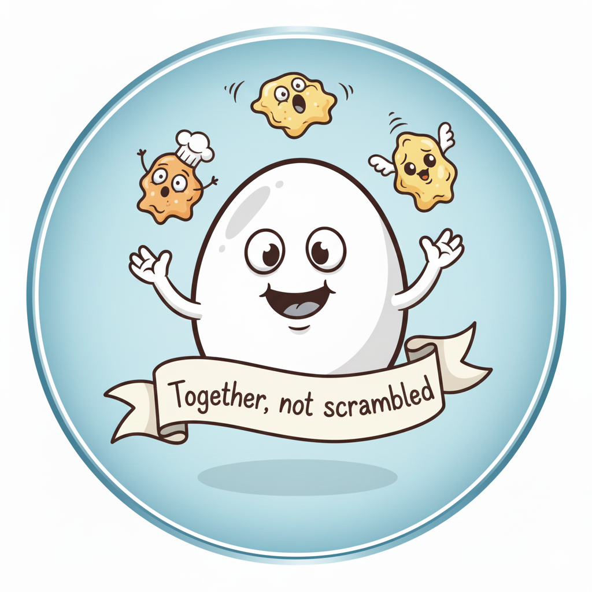

  

# Together, but not scrambled

Puts an end to alphabetical order bias in your stand-up queue.

Shuffle your Assignee list once per day so the same person isn't stuck starting or ending the meeting every single day. The order is seeded by the browser's current local date, so it stays stable throughout the day and resets the next day.

**Fairness, powered by chaos.**

## Browser packages

This repository includes a dedicated extension package for each browser:

- `chrome/` — Chrome and Chromium-based browsers
- `firefox/` — Firefox

There is also a legacy root-level package kept for backwards compatibility. Prefer loading the browser-specific folders for new installs.

## Chrome

1. Open `chrome://extensions`
2. Enable "Developer mode"
3. Click "Load unpacked"
4. Select the `chrome/` folder

## Firefox

1. Open `about:addons`
2. Click the gear menu and choose "Install Add-on From File..."
3. Select the `firefox/manifest.json` file or load the unpacked `firefox/` folder

## Notes

The extension targets GitHub Project boards at:

- `https://github.com/orgs/*/projects/*`
- `https://github.com/users/*/projects/*`

The logic is identical in both browser bundles so the behavior stays consistent across Chrome and Firefox.
